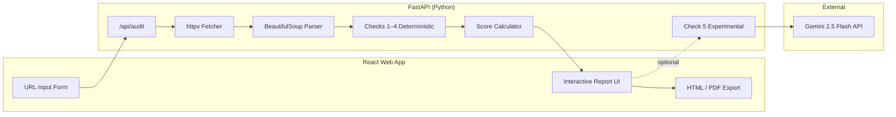

# GEO Auditor — Project Blueprint

**Source:** Phaze AI · Product Developer Take-Home Task  
**Role:** Product Developer (AI Products)  
**Time budget:** 8–12 focused hours (48-hour deadline)  
**Status:** Design frozen — single source of truth for implementation

---

## Table of Contents

1. [Assignment Understanding](#1-assignment-understanding)
2. [Hidden Expectations](#2-hidden-expectations)
3. [Evaluation Criteria and How to Maximize Each](#3-evaluation-criteria-and-how-to-maximize-each)
4. [Constraints](#4-constraints)
5. [Deliverables](#5-deliverables)
6. [Instant Rejection Conditions](#6-instant-rejection-conditions)
7. [Recommended Project Scope](#7-recommended-project-scope)
8. [Features We Should Intentionally NOT Build](#8-features-we-should-intentionally-not-build)
9. [GEO Research Plan](#9-geo-research-plan)
10. [Recommended GEO Checks](#10-recommended-geo-checks)
11. [Audit Report Design](#11-audit-report-design)
12. [Recommended Technical Architecture](#12-recommended-technical-architecture)
13. [Milestones (Each Under One Hour)](#13-milestones-each-under-one-hour)
14. [Design Status](#14-design-status-frozen)

---

## 1. Assignment Understanding

### The business problem

Search behavior is shifting from Google keyword search to AI answer engines (ChatGPT, Perplexity, Claude, Google AI Overviews). Businesses can rank #1 on Google and still be **invisible in AI-generated answers**, because AI engines select sources using different signals than traditional SEO.

**GEO (Generative Engine Optimization)** — also called AEO, LLMO, AI SEO — is the emerging discipline of making a business discoverable and citable in AI answers. Almost no business knows their current AI visibility. **That gap is the product opportunity.**

### What to build

A **GEO Auditor**: user enters a business (minimum: website URL) and receives an audit report covering:

| Output | Requirement |
|--------|-------------|
| **Visibility** | A score plus the evidence behind it |
| **What's broken** | Specific findings with proof — not generic advice |
| **What to fix** | Prioritized by impact vs. effort |

### What is deliberately unspecified (and graded)

- Tech stack, architecture, report format
- **Which checks to run** — figuring out what to measure is core to the task
- How deep vs. wide to go

### Core philosophy (from the PDF)

> *"The report is the product."*  
> *"Build for the moment the owner sees the report, realizes they have a problem, and finds the fix sitting right underneath it."*

This is a **product judgment exercise**, not a spec-following exercise. AI tools (Cursor, Claude Code, etc.) are expected. Reasoning matters as much as code.

---

## 2. Hidden Expectations

These are not always stated explicitly but strongly implied by scoring weights, rejection criteria, and "what gets you hired on the spot."

| Hidden expectation | Why it matters |
|--------------------|----------------|
| **You are the product manager** | They want decisions under ambiguity, not a checklist executor |
| **Research before building** | 30% weight on "Research & what you chose to check" — surface-level SEO repackaged as GEO will score low |
| **The "aha moment" is the deliverable** | Report must make a Google-happy business owner realize they have an invisible problem |
| **Evidence over assertions** | Every finding needs page-level proof: what was found, what should be instead |
| **Honest scope cuts** | Aggressive cuts with clear reasoning beat a broken 90% |
| **Real runs on unseen URLs** | Tool must work on businesses you didn't hand-pick for the demo |
| **README as thought leadership** | "Your README changes how we think about this problem" is a hire signal |
| **Defend skipped checks** | Saying "I skipped X because it was easy but shallow" is acceptable if honest |
| **Copy-paste fixes** | Don't describe fixes — hand them ready to use |
| **Business-owner language** | Jargon only with inline explanation |
| **Label all mocks** | Transparent mocks cost nothing; fake-real data is instant rejection |
| **Ask questions, but don't block** | Questions are positive; assumptions in README are required |
| **Video shows judgment, not features** | Loom should explain *why*, not just *what* |

---

## 3. Evaluation Criteria and How to Maximize Each

### Research & what you chose to check — **30%** (highest weight)

**What they want:** Evidence you entered an unfamiliar field, learned what drives AI visibility, and built checks that measure real signals.

**How to maximize:**

- Spend 2–3 hours on GEO research before writing code
- Document research sources and reasoning in README
- Choose 4–6 checks you can defend with "this is why AI engines cite source A over source B"
- Explicitly list checks you considered and rejected, with reasons
- Include at least one check that goes beyond repackaged SEO (e.g., live AI visibility probe, llms.txt, answer-extractability)
- Avoid obvious-only checks (meta title length, generic "mobile friendly") unless tied to AI citation behavior

### Report quality — **25%**

**What they want:** Output a business owner would pay for — specific, evidenced, prioritized, readable.

**How to maximize:**

- Design the report template **before** the software (see Section 11)
- Show score breakdown with visible math — no magic `73/100`
- Every finding: page URL ? what was found ? what's wrong ? copy-paste fix
- Prioritized action plan ordered by impact × effort
- Lead with the visibility gap ("You rank on Google but AI engines don't mention you because…")
- Run against 3 real businesses and include full outputs in submission

### Product judgment — **20%**

**What they want:** Right cuts, customer-centric thinking, not ticket execution.

**How to maximize:**

- Cut auth, billing, DB, deployment, tests, CI, mobile
- Target 3–5 real business types and document why
- README section: "What I cut and why"
- README section: "What I'd build next with another week"
- One narrow tool that works beats a wide tool that half-works

### Technical execution — **15%**

**What they want:** It runs, handles messy real sites, code is extendable.

**How to maximize:**

- README: runnable in under 5 minutes
- Graceful handling of timeouts, blocked pages, missing pages, JS-heavy sites
- Clean module boundaries: fetch ? analyze ? score ? report
- No crash on edge cases; degrade with labeled partial results
- Public or invitable GitHub repo with clear structure

### Communication — **10%**

**What they want:** README and 3–5 min Loom that explain decisions and tradeoffs.

**How to maximize:**

- README: run instructions, build/cut decisions, real vs. mocked, next steps
- Video: walk through tool + one real report; talk about *decisions*, not feature tour
- Honest about unfinished parts if any

---

## 4. Constraints

| Constraint | Detail |
|------------|--------|
| **Time** | 48-hour deadline; 8–12 focused hours expected |
| **Stack** | Any language, framework, model, API, tooling — zero restrictions |
| **AI tools** | Expected and not penalized |
| **Libraries** | Fine to use; do not hand-roll HTML parser |
| **Mocks** | Allowed if clearly labeled in code and README |
| **Scope** | Work well for 3–5 real businesses — not every website on the internet |
| **Depth vs. width** | Three checks done properly > twelve tick-box checks |

### Explicitly NOT required

- Auth, signup, billing, user accounts
- Database (unless genuinely needed)
- Production deployment (local run + demo video is fine; live link is a nice touch)
- Tests, CI, Docker
- Mobile responsiveness

---

## 5. Deliverables

Submit all four on the same thread:

| # | Deliverable | Requirements |
|---|-------------|--------------|
| 1 | **Code** | Public GitHub repo, or private with invite |
| 2 | **README** | Run in <5 min; what you built and cut; real vs. mocked; what you'd build next |
| 3 | **Three real audit reports** | Actual runs on three real businesses — not template screenshots |
| 4 | **3–5 min Loom** | Walk through tool and one report; explain decisions; no editing needed |

**Submission format:**  
Subject: `GEO Auditor — [Your Name]`

**If incomplete:** Ship what works; be honest. Working 40% + clear README beats broken 90%.

---

## 6. Instant Rejection Conditions

| Condition | Mitigation |
|-----------|------------|
| Tool only works on the one demo URL | Test on 3+ diverse real businesses before submit |
| Generic advice identical for any website | Page-specific evidence on every finding |
| Findings with no evidence | Attach URL, snippet, screenshot, or API response |
| Mocked results presented as live data | Label mocks in code, README, and report |
| Checks you can't explain | Document reasoning for each check and each skip |
| No submission by deadline with no heads-up | Communicate early if blocked |

---

## 7. Recommended Project Scope

### In scope (MVP)

- **React web app:** URL input ? Analyze ? interactive audit report in-browser
- **4 core deterministic GEO checks** (see Section 10) — no LLM required for scoring
- **Composite GEO Score (0–100)** calculated entirely from deterministic analysis, with visible breakdown
- **Optional experimental module:** Live AI Visibility Probe (Gemini 2.5 Flash) — separate from core score, clearly labeled
- **Report export:** HTML download (primary); PDF export (optional, implement only if trivial)
- **Thin Python backend** (FastAPI) to fetch, parse, run checks, and return JSON
- **3 pre-run example reports** included in repo (static HTML or saved JSON + screenshots)
- README + Loom video

### Crawl scope — intentional MVP decision

Each audit analyzes **at most 3 pages**:

| Page | Rule |
|------|------|
| **Homepage** | Always fetched |
| **About page** | Fetched if discoverable via nav/footer link (`/about`, `/about-us`, etc.) |
| **One service/product page** | Single most relevant page selected from nav (first match against patterns like `/services`, `/products`, `/solutions`, or largest nav section link) |

**Why this scope:**

- Keeps analysis fast (target: full audit in under 30 seconds)
- Reduces fetcher and parser complexity — no multi-page nav crawl
- Still yields enough evidence for specific, page-level findings across identity, schema, and content checks
- Honest limitation documented in every report

If About or a service page is not found, the audit continues with available pages and notes the gap in Limitations.

Additionally fetched (not counted toward 3-page content limit):

- `robots.txt`
- `/llms.txt`

### Target business profile

Choose businesses with:

- A real marketing website (not a SPA-only shell)
- Clear entity (local service, SaaS, agency, e-commerce)
- Mix of good and bad GEO hygiene for contrast

**Suggested test set (to validate during build):**

1. Local service business (plumber, dentist, law firm)
2. B2B SaaS company
3. E-commerce or D2C brand
4. One site you know has strong schema/FAQ
5. One site you know is SEO-strong but GEO-weak

### Out of scope for MVP

See Section 8.

### Time allocation (8–12 hours)

| Phase | Hours |
|-------|-------|
| GEO research + check selection | 1.5–2 |
| Report UI + template design (React) | 1.5–2 |
| Backend scaffold + fetcher/parser | 1.5–2 |
| Core check implementations (4 checks) | 2.5–3 |
| React app + report integration | 1.5–2 |
| Real business runs + polish | 1 |
| README + Loom | 0.5–1 |

**Scope guardrail:** React + FastAPI adds surface area vs. a CLI. Keep the backend a thin JSON API with no auth, no DB, and no background job queue. If export or the experimental probe threatens the deadline, ship the interactive report first and defer export/probe with honest README notes.

---

## 8. Features We Should Intentionally NOT Build

| Feature | Reason to skip |
|---------|----------------|
| User auth / signup / billing | Explicitly excluded |
| Database / user history | Not needed for MVP; file-based output suffices |
| Production deployment | Local run + video is sufficient |
| Tests, CI, Docker | Not graded |
| Mobile-responsive UI | Not graded |
| Universal website support | Target 3–5 business types; document limitations |
| 12+ shallow checks | Violates "go deep, not wide"; scores low on research |
| Full SEO audit (backlinks, keyword density, PageSpeed) | Wrong discipline unless tied to AI citation |
| Competitor benchmarking dashboard | Scope creep; one competitor mention in AI probe is enough |
| Automated fix deployment | Report delivers copy-paste fixes; no CMS integration |
| Real-time monitoring / alerts | Product for another week |
| Multi-language support | Adds complexity without grading benefit |
| PDF export (if time-constrained) | HTML export is sufficient; PDF is nice-to-have only |
| **Playwright / headless browser** | Explicitly removed; JS-heavy sites reported as a limitation |
| **CLI as primary interface** | Replaced by React web app |
| **OpenAI / Anthropic APIs** | Replaced by Gemini 2.5 Flash (free tier) for optional LLM use only |
| **Live AI probe in core score** | Optional/experimental; core score stays deterministic |
| **Background job queue / WebSockets** | Polling or synchronous analyze is enough for 3-page crawls |

---

## 9. GEO Research Plan

Research should happen **before** choosing checks or writing code. Budget **2–3 hours**.

### Phase A — Understand AI citation behavior (60 min)

**Goal:** Learn what makes AI engines pick source A over source B.

| Activity | Sources / method |
|----------|------------------|
| Read foundational GEO content | Search: "Generative Engine Optimization," "AEO," "LLMO," "AI search visibility" |
| Study practitioner writeups | Ahrefs, Semrush, Search Engine Journal, Moz posts on AI Overviews / GEO (2024–2026) |
| Manual AI probing | Pick 5 known brands + 5 obscure local businesses; ask ChatGPT, Perplexity, Claude: *"Who is [business]?"*, *"Best [service] in [city]"* — note who gets cited and why |
| Observe citation patterns | When AI cites a source, visit that page — what structure, schema, facts, formatting do cited pages share? |

**Capture in a research log:**

- Signals that appear repeatedly in cited pages
- Signals on uncited but Google-ranking pages
- Gaps between traditional SEO and GEO

### Phase B — Survey early GEO tools (45 min)

**Goal:** See what exists; differentiate, don't copy blindly.

| Tool category | What to note |
|---------------|--------------|
| Early GEO auditors | Which checks they run; which feel shallow vs. substantive |
| llms.txt adopters | [llmstxt.org](https://llmstxt.org) — who publishes, what format |
| AI crawler policies | GPTBot, ClaudeBot, PerplexityBot, Google-Extended in robots.txt |

**Decision output:** List of candidate checks with pros/cons.

### Phase C — Technical signal mapping (45 min)

**Goal:** Map research to automatable checks.

| Research insight | Automatable? | Evidence type | LLM needed? |
|------------------|--------------|---------------|-------------|
| AI bots blocked in robots.txt | Yes | robots.txt lines | No |
| Missing Organization/FAQ schema | Yes | JSON-LD snippets | No |
| No answer-ready content (definitions, FAQs) | Yes (heuristics) + optional Gemini summary | Page excerpts, pattern counts | Optional (Gemini 2.5 Flash) |
| Not mentioned when AI is queried | Yes (API call) | AI response excerpt | Yes — **experimental only** |
| No llms.txt | Yes | HTTP status + content | No |
| Generic marketing copy vs. citable facts | Heuristics first; Gemini for narrative | Filler-ratio, fact counts | Optional |

**Cost note:** Gemini 2.5 Flash free tier covers MVP usage (a few page analyses + optional probe per audit). Keep prompts short and batch content to stay nearly free.

### Phase D — Synthesize and document (30 min)

Produce a **Check Selection Memo** for README:

- Final 4 core + 1 experimental check with one-paragraph justification each
- 5+ checks considered and rejected, with honest reasons
- Assumptions made (e.g., "We assume business name can be inferred from homepage title")

---

## 10. Recommended GEO Checks

**Principle:** Go deep, not wide. Core score = 4 deterministic checks. Fifth check is optional/experimental.

---

### Core checks (determine GEO Score — 100 points total)

---

#### Check 1: AI Crawler Access Gate

**Weight:** 20 points

**What it measures:** Whether AI training and retrieval crawlers can access the site's content.

**Why it belongs:**

- If GPTBot, ClaudeBot, PerplexityBot, or Google-Extended are blocked in `robots.txt`, the site may be excluded from AI indexation and citation
- This is GEO-specific — traditional SEO audits rarely flag AI bot blocks
- Fully automatable with clear evidence (exact robots.txt lines)

**Evidence collected:**

- Full or relevant `robots.txt` excerpt
- Per-bot status: Allowed / Blocked / Not mentioned
- Presence and quality of `/llms.txt` (emerging standard for AI-readable site summaries)

**Finding example:**

> **Blocked:** `User-agent: GPTBot` ? `Disallow: /`  
> **Impact:** ChatGPT's crawler cannot index your content.  
> **Fix:** [copy-paste robots.txt amendment]

**Confidence:** High (objective robots.txt / HTTP observation)

---

#### Check 2: Entity Identity Clarity

**Weight:** 25 points

**What it measures:** Can an AI unambiguously answer "Who is this business, what do they do, where are they?"

**Why it belongs:**

- AI engines build entity graphs; ambiguous or missing identity = no citation
- Google Knowledge Panel logic overlaps, but GEO needs machine-readable identity on-site
- Business owners don't realize a vague About page hurts AI visibility

**Evidence collected:**

- Homepage H1 and first 200 words — is the business name + category + location stated clearly?
- About/Contact page presence and clarity
- `Organization` or `LocalBusiness` JSON-LD — present, partial, or missing
- NAP consistency (Name, Address, Phone) across homepage and contact page

**Finding example:**

> **Page:** `/about` — No explicit statement of what the company does. H1 is "Welcome."  
> **Should be:** "Acme Plumbing is a licensed residential plumbing company serving Austin, TX since 2004."  
> **Fix:** [copy-paste paragraph + Organization schema block]

**Confidence:** High for missing schema; Medium for inferred weak entity clarity

---

#### Check 3: Structured Data for AI Extraction

**Weight:** 25 points

**What it measures:** Presence and quality of schema.org markup that helps AI parse products, services, FAQs, and articles.

**Why it belongs:**

- AI systems heavily use structured data to extract facts for answers
- Missing `FAQPage`, `Product`, `Service`, or `Article` schema = lost citation opportunities
- Evidence is objective (JSON-LD present or not) with copy-paste fixes

**Evidence collected:**

- Inventory of JSON-LD types found on crawled pages (homepage, About, service/product page)
- Gap list: expected schema for business type vs. found
- Validation errors if any

**Finding example:**

> **Missing:** `FAQPage` schema on `/faq` despite 12 FAQ items in HTML.  
> **Fix:** [copy-paste FAQPage JSON-LD for all 12 questions]

**Confidence:** High (objective schema presence/absence)

---

#### Check 4: Answer-Ready Content Structure

**Weight:** 30 points

**What it measures:** Whether key pages contain extractable, citable content — not just marketing fluff.

**Why it belongs:**

- AI engines prefer pages with clear definitions, Q&A format, lists, statistics, and attributed facts
- A #1 Google rank with "We are the leading provider of innovative solutions" won't get quoted
- This is the core GEO insight: **cite-worthiness ? rank-worthiness**

**Pages analyzed:** Homepage, About (if present), one service/product page — same 3-page crawl scope as all checks.

**Scoring approach — deterministic first, Gemini optional for narrative only:**

| Signal | Method | Points (of 30) |
|--------|--------|----------------|
| Definitional sentences ("X is…", "We are…") | Regex/heuristic on page text | Up to 8 |
| FAQ-style headings or FAQPage schema | HTML structure + schema | Up to 8 |
| Specific facts (numbers, dates, locations, credentials) | Pattern matching | Up to 8 |
| Generic filler ratio | Heuristic (vague phrase list vs. fact density) | Up to 6 |

**Gemini 2.5 Flash (optional, not required for score):** After deterministic scoring, one batched prompt summarizes the worst page and suggests a copy-paste rewrite. If the API call fails or is skipped, the check still produces a full scored result from heuristics alone.

**Scope guardrail:** Do not crawl beyond the 3-page scope. Do not run Gemini per-page — one batched call maximum.

**Finding example:**

> **Page:** `/services/drain-cleaning`  
> **Found:** "We offer the best drain cleaning services with unmatched quality."  
> **Problem:** No price range, service area, process steps, or credentials AI can quote.  
> **Fix:** [copy-paste 150-word factual rewrite + 3 FAQ items]

**Confidence:** Medium for heuristic content analysis; High when specific patterns are matched

---

### Finding schema (applies to all checks 1–4)

Every finding must include:

| Field | Values / content |
|-------|------------------|
| **Severity** | Critical / High / Medium / Low |
| **Confidence** | High / Medium / Low |
| **Evidence** | Exact URL, snippet, or extracted data |
| **Why it matters** | One plain-English sentence for the business owner |
| **Recommended fix** | Copy-paste ready text or code block |

**Confidence guidelines:**

| Confidence | When to use | Examples |
|------------|-------------|----------|
| **High** | Objective, directly observed fact | Missing FAQ schema; GPTBot blocked in robots.txt; no Organization JSON-LD |
| **Medium** | Strong heuristic inference, not a binary fact | Generic marketing copy detected; weak entity clarity inferred from vague H1/intro |
| **Low** | Weak signal or partial data (e.g., page not found) | About page not located; service page inferred from ambiguous nav label |

Deterministic checks should mostly produce **High** confidence findings. Heuristic checks (especially Check 4) should use **Medium** where appropriate and never present inference as certainty.

---

### Optional / experimental check (NOT in core score)

---

#### Check 5: Live AI Visibility Probe (experimental)

**Weight:** 0 points in core score — displayed separately as "Experimental AI Visibility"

**What it measures:** When Gemini is asked about this business, does it mention or describe them accurately?

**Why keep it (but demote):**

- Still the strongest differentiator and "aha moment" driver
- Depends on external API, non-deterministic, may vary run-to-run
- Treating it as experimental avoids scoring instability and API-cost risk

**UI treatment:**

- Separate button: **"Run experimental AI visibility check"** after core audit completes
- Results shown in their own section with banner: *"Experimental — not included in your GEO Score"*
- If API unavailable: section shows "Skipped" with reason; core report unaffected

**Implementation:**

- Gemini 2.5 Flash API, 2 standardized prompts
- Capture: mentioned (yes/no), response excerpt, accuracy note
- Label clearly in report footer and README as live API output

**Why not in core score:** Non-reproducible, API-dependent, and outside the 8–12 hour critical path. Core audit must work offline from deterministic analysis alone.

---

### Checks intentionally NOT included

| Skipped check | Honest reason |
|---------------|---------------|
| Page speed / Core Web Vitals | SEO metric; weak direct link to AI citation; easy but shallow |
| Meta title/description length | Obvious, surface-level; scores low on research |
| Backlink profile | Requires paid APIs; hard to do well in 12 hours; indirect GEO signal |
| Social media presence | Hard to automate reliably; fuzzy evidence |
| Wikipedia/Wikidata presence | Rare for SMBs; narrow applicability |
| Image alt text audit | Minor GEO signal; low impact for effort |
| 12-point technical SEO checklist | Violates "go deep not wide"; generic report risk |

---

## 11. Audit Report Design

The report is the product. Design this first; software serves the report schema.

### UX flow

```
[Landing: URL input + optional business name]
        ?  "Analyze"
[Loading state — progress: Fetching ? Checking ? Scoring]
        ?
[Interactive Report — score hero, breakdown, findings, action plan]
        ?  optional
[Run Experimental AI Visibility Check]
        ?  optional
[Export HTML / PDF]
```

### Report structure

```
???????????????????????????????????????????????????????????????
?  GEO VISIBILITY AUDIT                                       ?
?  [Business Name] · [domain.com] · [Audit Date]              ?
???????????????????????????????????????????????????????????????
?  1. EXECUTIVE SUMMARY                                       ?
?     • GEO Score: 58/100  (Grade: At Risk)                   ?
?     • One-sentence verdict                                  ?
?     • "Aha" line (from deterministic findings)              ?
???????????????????????????????????????????????????????????????
?  2. SCORE BREAKDOWN                                         ?
?     ????????????????????????????????????????????????        ?
?     ? Check            ? Score  ? Weight ? Weighted?        ?
?     ????????????????????????????????????????????????        ?
?     ? AI Crawler Access?  8/20  ?   20%  ?    8    ?        ?
?     ? Entity Clarity   ? 15/25  ?   25%  ?   15    ?        ?
?     ? Structured Data  ? 12/25  ?   25%  ?   12    ?        ?
?     ? Answer-Ready     ? 23/30  ?   30%  ?   23    ?        ?
?     ????????????????????????????????????????????????        ?
?     ? TOTAL            ?        ?  100%  ?   58    ?        ?
?     ????????????????????????????????????????????????        ?
?     (All checks above are deterministic — no AI API used)   ?
???????????????????????????????????????????????????????????????
?  3. FINDINGS BY CATEGORY (Checks 1–4)                       ?
?     [Severity | Confidence | Page | Found | Why | Fix]      ?
???????????????????????????????????????????????????????????????
?  4. PRIORITIZED ACTION PLAN (Impact × Effort)               ?
???????????????????????????????????????????????????????????????
?  5. WHAT YOU'RE DOING WELL                                  ?
???????????????????????????????????????????????????????????????
?  6. LIMITATIONS & METHODOLOGY                               ?
?     • Pages analyzed: Homepage + About (if found) + 1       ?
?       service/product page                                  ?
?     • Intentional MVP scope: 3 pages max for speed          ?
?     • Fetch method: httpx + BeautifulSoup (no JS rendering) ?
?     • JS-heavy site warning if detected                     ?
?     • What's real vs. mocked                                ?
???????????????????????????????????????????????????????????????
?  7. HOW THIS SCORE WAS CALCULATED                           ?
?     (See dedicated section below)                           ?
???????????????????????????????????????????????????????????????
?  8. EXPERIMENTAL: AI VISIBILITY (optional, separate)          ?
?     [Run/check results — NOT in score above]                ?
?     Banner: "Experimental — results may vary"               ?
???????????????????????????????????????????????????????????????
?  [Export HTML]  [Export PDF — if implemented]               ?
???????????????????????????????????????????????????????????????
```

### Finding card structure

Each finding in the interactive report and exports:

```
???????????????????????????????????????????????????????????
?  [Severity badge]  [Confidence badge]                 ?
?  Finding title                                          ?
?  Page: https://example.com/about                        ?
?                                                         ?
?  What we found:                                         ?
?  [exact evidence — robots.txt line, schema gap, quote]  ?
?                                                         ?
?  Why it matters:                                        ?
?  [one sentence, no jargon]                              ?
?                                                         ?
?  Recommended fix:                    [Copy]             ?
?  [copy-paste ready block]                               ?
???????????????????????????????????????????????????????????
```

**Confidence badge styling:** High = solid; Medium = outlined; Low = muted — so owners can instantly see deterministic vs. inferred findings.

### How This Score Was Calculated (report section 7)

```
???????????????????????????????????????????????????????????????
?  HOW THIS SCORE WAS CALCULATED                              ?
?                                                             ?
?  Your GEO Score is calculated entirely from deterministic   ?
?  analysis — no AI API calls are used in scoring.            ?
?                                                             ?
?  The score is composed of four core checks:                 ?
?    • AI Crawler Access (20 points)                          ?
?    • Entity Clarity (25 points)                             ?
?    • Structured Data (25 points)                            ?
?    • Answer-Ready Content (30 points)                       ?
?                                                             ?
?  Every point is backed by evidence shown in the findings    ?
?  above. Expand any finding to see the exact page, data,     ?
?  or snippet that determined its score contribution.         ?
?                                                             ?
?  Findings marked Medium or Low confidence use heuristics     ?
?  (pattern matching or inference) rather than binary facts.  ?
?  These are clearly labeled so you can judge how much        ?
?  weight to give them.                                       ?
?                                                             ?
?  The Experimental AI Visibility Probe (below) is displayed  ?
?  separately and does not affect your GEO Score.             ?
???????????????????????????????????????????????????????????????
```

### JS-heavy site detection

If fetched HTML is a thin shell (< 500 chars body text, or `<div id="root"></div>` with no content), emit a **Limitation** finding:

> **JavaScript-rendered site detected.** This audit analyzes server-delivered HTML only. Key content may be missing from results. Consider server-side rendering or static snapshots for AI crawlers.

This replaces Playwright — honest limitation instead of added complexity.

### Score calculation

| Check | Max | Scoring logic |
|-------|-----|---------------|
| AI Crawler Access | 20 | Per-bot allow/block; llms.txt presence |
| Entity Clarity | 25 | H1 clarity, About page, Organization schema, NAP |
| Structured Data | 25 | Expected schema types present + valid for business category |
| Answer-Ready Content | 30 | Deterministic heuristics across up to 3 content pages |
| Live AI Visibility | — | **Excluded from core score** |

**Grade bands:**

- 80–100: Strong
- 60–79: Moderate gaps
- 40–59: At risk
- 0–39: Critical

### Report format

| Format | Role |
|--------|------|
| **Interactive React UI** | Primary — in-app report with expandable findings, copy buttons |
| **HTML export** | Download self-contained HTML (inline CSS) for sharing |
| **PDF export** | Optional — via browser print-to-PDF or a lightweight lib; skip if > 1 hour |

### UX principle

Business owner opens report ? sees score + "aha" line in first 10 seconds ? scrolls to prioritized fixes ? copies fix #1 into their CMS Monday morning.

---

## 12. Recommended Technical Architecture

### Architecture diagram



### Recommended stack

| Layer | Choice | Rationale |
|-------|--------|-----------|
| **Frontend** | React + Vite + TypeScript | Assignment-friendly demo UX; interactive report |
| **Styling** | Tailwind CSS or plain CSS modules | Fast polish for Loom demo; keep minimal |
| **Backend** | FastAPI (Python 3.11+) | Thin JSON API; same language as checks |
| **HTTP fetching** | `httpx` | Async-friendly, simple |
| **HTML parsing** | `beautifulsoup4` | Assignment allows libraries; no hand-rolled parser |
| **Schema extraction** | JSON-LD parsing from soup | Deterministic |
| **LLM (optional only)** | **Gemini 2.5 Flash API** | Free tier; used for experimental probe + optional rewrite suggestion |
| **Export** | HTML: template string or React snapshot; PDF: browser print or `weasyprint` if time | HTML first |

**Removed from stack:** Playwright, OpenAI, Anthropic, CLI-first entry, Jinja2 as primary report path.

### Module structure

```
geo-auditor/
??? backend/
?   ??? main.py                 # FastAPI app, CORS for React dev
?   ??? fetcher.py              # httpx — homepage, robots.txt, llms.txt, 3 content pages
?   ??? parser.py               # BeautifulSoup ? page objects
?   ??? checks/
?   ?   ??? crawler_access.py   # Check 1
?   ?   ??? entity_clarity.py   # Check 2
?   ?   ??? structured_data.py  # Check 3
?   ?   ??? answer_ready.py     # Check 4 (heuristics + optional Gemini)
?   ?   ??? ai_visibility.py    # Check 5 (experimental, separate endpoint)
?   ??? scoring.py
?   ??? models.py               # Pydantic models ? JSON to frontend
??? frontend/
?   ??? src/
?   ?   ??? App.tsx
?   ?   ??? components/
?   ?   ?   ??? UrlInput.tsx
?   ?   ?   ??? AuditProgress.tsx
?   ?   ?   ??? ScoreHero.tsx
?   ?   ?   ??? ScoreBreakdown.tsx
?   ?   ?   ??? FindingCard.tsx
?   ?   ?   ??? ActionPlan.tsx
?   ?   ?   ??? MethodologySection.tsx
?   ?   ?   ??? ExperimentalProbe.tsx
?   ?   ??? utils/exportHtml.ts
?   ??? package.json
??? examples/                   # 3 real audit JSON + screenshots
??? README.md
```

### API design

| Endpoint | Method | Purpose |
|----------|--------|---------|
| `POST /api/audit` | POST | `{ url, business_name? }` ? full deterministic audit JSON |
| `POST /api/audit/ai-visibility` | POST | `{ url, business_name }` ? experimental probe result (optional) |
| `GET /health` | GET | Sanity check for README setup |

**No WebSockets.** Synchronous `POST /api/audit` with 30–60s timeout is fine for a 3-page crawl. Show a loading spinner in React.

### Fetcher behavior

`fetcher.py` crawl logic:

1. Fetch homepage
2. Parse nav/footer links ? locate About page URL (pattern match)
3. Parse nav links ? select **one** service/product page (first pattern match; fallback: skip with Low-confidence limitation finding)
4. Fetch robots.txt and llms.txt (not counted toward 3-page content limit)

**Maximum content pages per audit: 3.** No additional nav crawl.

### Data models

```python
# Finding model — required fields
severity: Literal["critical", "high", "medium", "low"]
confidence: Literal["high", "medium", "low"]
evidence: str
why_it_matters: str
recommended_fix: str
page_url: Optional[str]
title: str
```

### Error handling

| Condition | Behavior |
|-----------|----------|
| Page timeout (15s) | Skip page, note in limitations |
| JS-heavy empty shell | Limitation finding; score from available pages |
| Invalid URL | 400 with clear message in UI |
| Gemini API failure | Core audit unaffected; experimental section shows error |
| robots.txt 404 | Treat as "not found" — finding, not crash |

### Cost control

- Gemini 2.5 Flash free tier: batch prompts, max 1 call for content suggestion + 2 for experimental probe
- No LLM calls on the critical path for scoring
- Estimated cost per audit: **$0** on free tier

### Scope simplifications

| If time is tight | Simplify to |
|------------------|-------------|
| PDF export | Skip; HTML export + browser Print to PDF in Loom |
| Experimental AI probe | Ship UI placeholder + README "next week" note |
| Gemini content rewrite | Heuristics-only Check 4 still fully scored |
| Fancy React animations | Static report layout is fine |
| Further crawl reduction | Homepage + robots.txt + llms.txt only (document in README) |

---

## 13. Milestones (Each Under One Hour)

| # | Milestone | Time | Done when |
|---|-----------|------|-----------|
| M1 | GEO research + check selection memo | 45–60 min | 4 core + 1 experimental check documented |
| M2 | Report UI mock (React static components with fake data) | 45–60 min | All report sections render; score breakdown visible |
| M3 | Backend scaffold + Pydantic models + `/health` | 30–45 min | FastAPI runs; models defined |
| M4 | Fetcher + parser (httpx + BeautifulSoup) | 45–60 min | Homepage, About (if found), 1 service/product page, robots.txt, llms.txt; JS-shell detection |
| M5 | Checks 1–2 (Crawler Access + Entity Clarity) | 45–60 min | Findings include severity + confidence + evidence + fix |
| M6 | Checks 3–4 (Structured Data + Answer-Ready heuristics) | 45–60 min | Deterministic scoring complete; Check 4 uses Medium confidence for heuristic results |
| M7 | Scoring + `POST /api/audit` | 30–45 min | End-to-end JSON audit from URL |
| M8 | React app: input ? loading ? report from API | 45–60 min | Full user flow works locally |
| M9 | Export HTML + copy-paste buttons on findings | 30–45 min | Downloadable report file |
| M10 | Experimental AI probe (optional endpoint + UI section) | 45–60 min | Separate from score; labeled experimental |
| M11 | Run on 3 real businesses; fix edge cases | 45–60 min | 3 example outputs in `examples/` |
| M12 | README + Loom | 45–60 min | < 5 min setup; video walks one real report |

**Total:** ~9–11 hours. **Critical path:** M1–M9 (core product). M10 is stretch. PDF export is drop-if-needed.

### Minimum viable ship

If only ~6 hours: M1–M9 minus M10 (no experimental probe), skip PDF, 2 business examples instead of 3. Core flow: **URL ? Analyze ? Interactive Report with deterministic score** — still meets assignment requirements.

### Execution order

```
M1 ? M2 ? M3 ? M4 ? M5 ? M6 ? M7 ? M8 ? M9 ? M11 ? M12
                                              ? M10 (stretch)
```

Report template (M2) before check code ensures every check outputs the evidence shape the report expects.

---

## 14. Design Status: FROZEN

| Decision | Locked value |
|----------|--------------|
| Crawl scope | Homepage + About (if present) + 1 service/product page |
| Finding schema | Severity, Confidence, Evidence, Why, Fix |
| Methodology section | "How This Score Was Calculated" in every report |
| Core score | 4 deterministic checks, 100 points |
| LLM | Gemini 2.5 Flash, optional/experimental only |
| Stack | React + FastAPI + httpx + BeautifulSoup |
| UX | URL ? Analyze ? Interactive Report ? optional export |

### Summary

| Dimension | Recommendation |
|-----------|----------------|
| **Product** | Narrow GEO Auditor: URL in ? evidenced, prioritized interactive report out |
| **Checks** | 4 core deterministic + 1 optional experimental AI probe |
| **Differentiator** | Answer-ready content analysis + optional live AI probe — not repackaged SEO |
| **Primary artifact** | Interactive React report with visible score math, confidence labels, and copy-paste fixes |
| **Cut aggressively** | Auth, DB, deploy, tests, mobile, Playwright, universal site support |
| **Success criterion** | Evaluator runs it on an unseen URL and gets a genuinely useful, specific report |

---

*This document is the single source of truth for all implementation milestones.*
